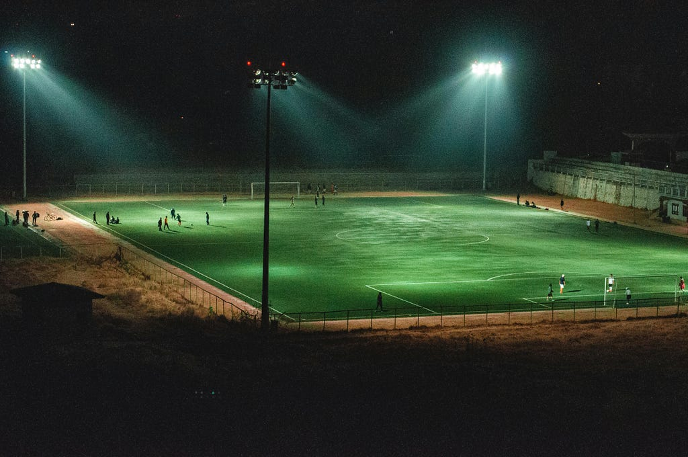

Before you begin, let me share something. When I wrote this, I wasn't just telling a story — I was walking through it. There was a quiet corner where I sat, a cup of coffee beside me, the world outside still. I put on my headphones, pressed play on the following track, and let the sound carry me.

<figure class="media-embed">
  <iframe
    title="The Hanging Tree (From The Hunger Games: Mockingjay) on Spotify"
    src="https://open.spotify.com/embed/track/4nN3gzMZxlVenucgg8P173?utm_source=generator"
    width="100%"
    height="152"
    allow="autoplay; clipboard-write; encrypted-media; fullscreen; picture-in-picture"
    loading="lazy">
  </iframe>
  <figcaption>Play this for a much better experience · <a href="https://open.spotify.com/track/4nN3gzMZxlVenucgg8P173">Open in Spotify</a></figcaption>
</figure>

The words came slow, heavy, almost breathing themselves into existence. I want you to feel that. So please — find your own quiet corner, brew that coffee, connect your headphones, get to your Spotify and play the track from the start, and read slowly. Let it sink in. This is how I lived it. This is how I want you to live it too.

<figure class="photo-figure">
  
  <figcaption>Photo by Yanni Shams on <a href="https://www.pexels.com/photo/green-grass-football-field-during-night-time-4122451/">Pexels</a></figcaption>
</figure>

The tunnel is a coffin, narrow and swallowing — each step a descent into silence and dread. Men shuffle inside it, pretending to be warriors, yet you can hear their breath betray them. Then the rhythm begins — those footsteps. Heavy, relentless, echoing deep within your chest, drowning out all hope. You feel it before you see it. The air turns viscous, sound collapsing into silence. The stadium itself feels complicit. Floodlights blaze like cold, unyielding suns, casting pale shadows that twist and claw at your skin. Shadows stretch unnaturally, curling like fingers around the defenders. You dare not look, but you know. Everyone knows. The one who comes does not arrive to play. He arrives to take.

When the doors swing open, light pours in — but it does not comfort you. The roar of the crowd rises like a desperate prayer, cracking and breaking beneath the weight of inevitability. Every entrance beneath these floodlights carries a shift — a whisper of fate. The ritual begins. He waits. Cold sweat drips. Hearts hammer. Swallowing becomes a trial. Short breaths. Clipped heartbeats. He is patience incarnate. For a moment, you believe he is mortal. Then he moves. The first strike — swift as a death knell. Merciless. Final. Silence. Reverence. Ruin.

A leap into the night, limbs stretching beyond human bounds — an unholy distortion of grace and doom. The ball shatters the silence like a blade through fog. And the crowd does not cheer. They erupt in awe. You taste iron in your mouth. You tell yourself it is breath, but deep down, you know — it is dread incarnate. The sound of boots echoes like a metronome counting down your doom.

Night after night, in citadels scattered across the continent, the pattern repeats. Munich falls, its fortress undone as if by sorcery. Metropolitano crumbles, defenders hollowed into whispers. Turin stands immortal, having toppled legends. Juventus, proud over conquering his rival trio, bows before the floodlights. Their victory becomes dust. Their walls cleaved. The cathedral of Turin echoes with one perfect strike — a bicycle of ruin that becomes scripture. Then, the nod. One deliberate, measured movement as the Champions League anthem swells. Not a glance, not triumph — something far darker. A silent decree. The game was over before it even began. Careers bend beneath that moment. Clubs tremble. Legends fade.

Voices whisper in dressing rooms long after: "We were never prepared." "It's like facing a ghost." "He takes more than goals — he takes belief." These murmurs become part of the myth.

There comes a night unlike any other. Not simply a game, but an awakening. The Night of the Omen. For those who survive, the meaning is carved into memory. Careers, clubs, legacies — written off before the whistle. A curse. Defenders feel it. Even beyond the stadium, he seeps into your nights — twisting dreams, poisoning thoughts, stalking your every waking moment. Players jerk awake, eyes wide to shadows in their peripheral vision. Boots echo in empty halls. Cold fingers brush their skin — always there, even when unseen. Sleep becomes impossible. Reality warps. Crowds whisper his name in tones that twist between awe and malice.

Atlético splinters. Bavaria dissolves. Juventus crumbles. Careers break — not only under fatigue but under the weight of terror. Bodies shattered. Eyes haunted. Minds unravel. Survivors speak in trembling voices of sleepless years. The phantom lingers in their shadows. It is not a legend. It is a curse.

You stand against him. The ball is at your feet. Control shatters. You crumble. He takes it all — hope, pride, all that made you human. Only extinction remains.

The scoreboard tells lies. What matters is the suffering. Cold sweat. Racing heartbeat. The silence afterwards. The certainty. Your fate was etched in shadows before your first breath — your story ended before it even began. Destiny. Greatness. Horror. A nightmare draped in flesh.

He keeps his cruelties for decisive nights. The early evenings are whispers. The group stage a false dawn. But winter dies, spring approaches — he sharpens. Quarterfinal — his theatre of dismemberment. Semifinal — his altar. Final — his coronation.

Only extinction.

He is the Final Boss. The last shadow crossing your threshold.

And there is no respite in time. Seasons turn. Years fade. He endures. Age does not weaken him — it hardens him. With each passing year, Europe trembles when the anthem rises. Because somewhere, still, waiting, is the phantom of the floodlights.

They will tell children of the goals. The leaps. The strikes. The impossible nights. But they will never capture the truth — the clammy breath before kickoff, the dread when he tilted his head, the silence after hope was taken. That is the part no highlight reel can capture. That is the part that keeps you awake.

And when floodlights dim, stadiums empty, and your eyes finally close — there is no escape. No end. Only his shadow, eternal.

Boots. Tap. Tap. Tap.

A shadow. An inevitability.

Even when he is gone, his myth remains. A dark inheritance for every generation. The final boss is eternal ! Siuuu ❤
